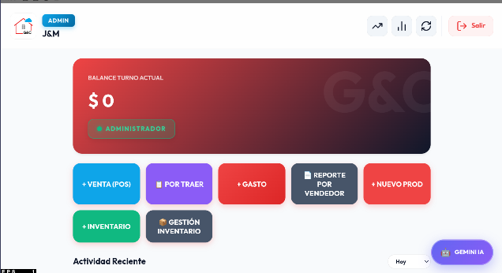
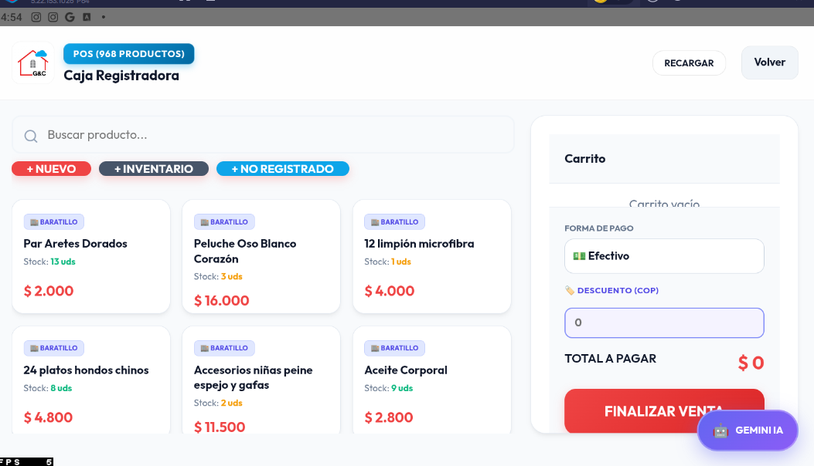
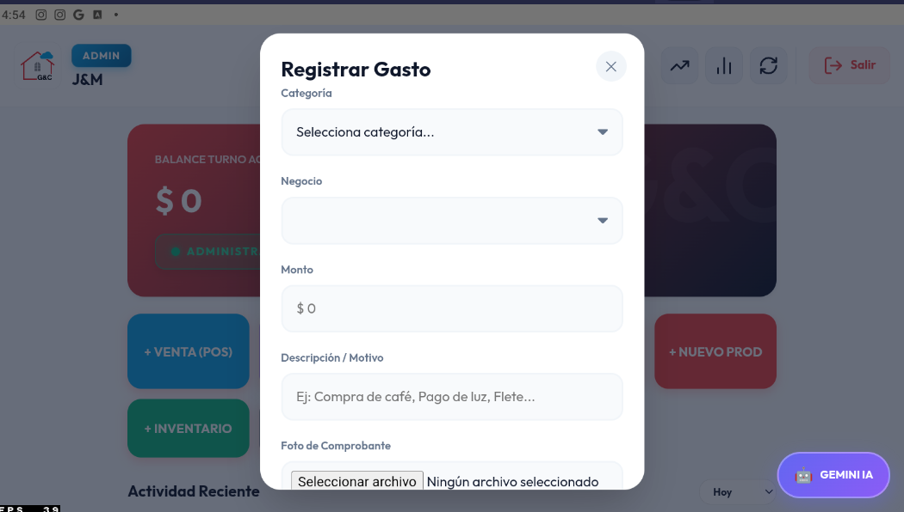
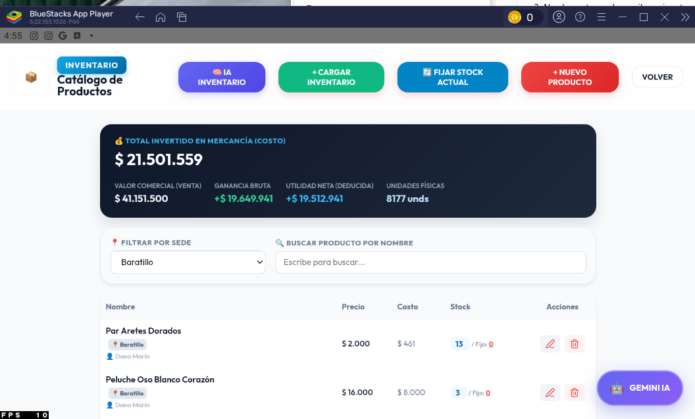
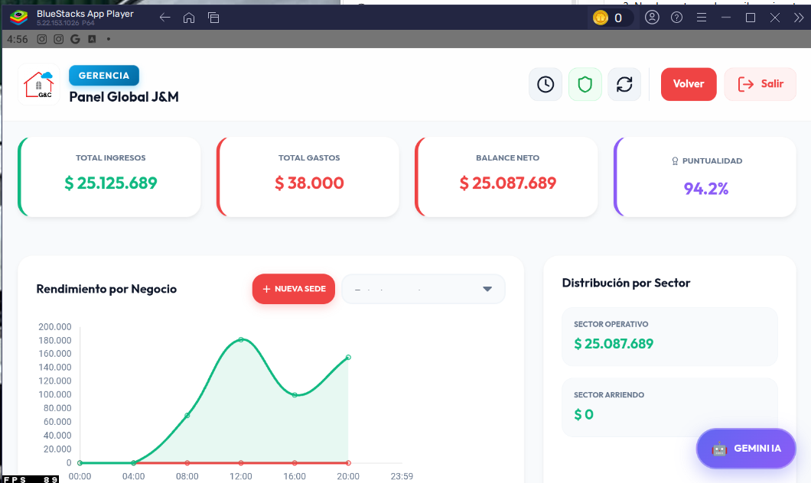
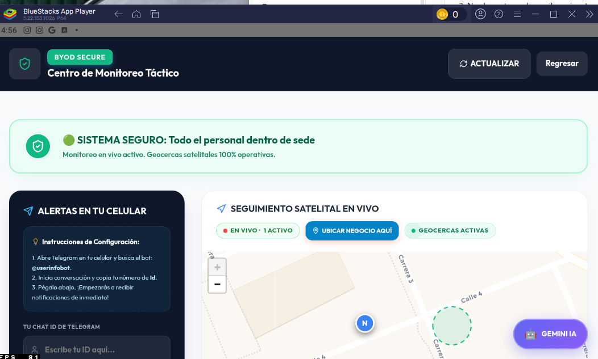
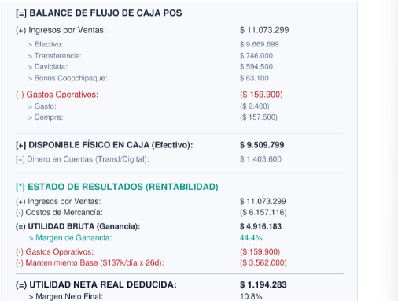
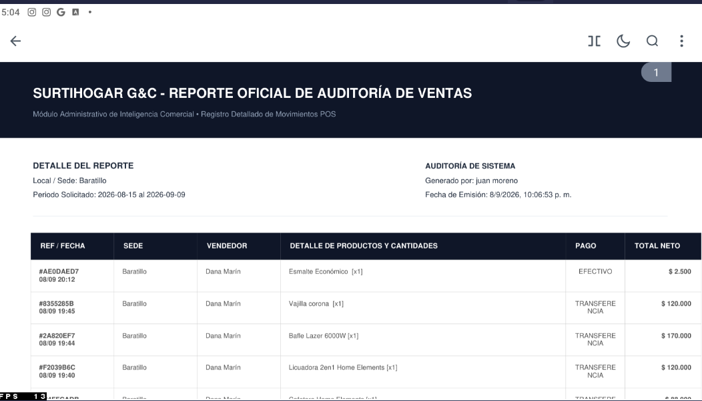

# SurtiHogar — Sistema de Gestión Multi-Negocio, POS y Control Financiero

[](https://vitejs.dev/)
[](https://developer.mozilla.org/es/docs/Web/JavaScript)
[](https://supabase.com/)
[](https://capacitorjs.com/)
[](https://vitest.dev/)
[](#12-autor-y-objetivo-del-proyecto-como-portafolio)

> **Nota de Portafolio Profesional:**
> SurtiHogar es un sistema de gestión empresarial orientado a centralizar operaciones de punto de venta, inventario, gastos, seguimiento financiero y administración multi-negocio. El proyecto incorpora herramientas de análisis, automatización y control de acceso para apoyar la gestión operativa. Desarrollado como proyecto de portafolio Full Stack para demostrar modelado relacional en PostgreSQL con Row-Level Security (RLS), diseño de microservicios con Node.js y construcción de aplicaciones SPA reactivas. este representa un producto comercial con usuarios activos y se encuentra desplegado en producción comercial, sin estar publicado en plataformas, es un proyecto de uso privado. desarrollado a medida para un cliente.

---

## 1. Descripción del Proyecto

SurtiHogar integra en una interfaz web y móvil ligera los flujos críticos de una red comercial con múltiples puntos de venta físicos:
- **Punto de Venta (POS):** Facturación rápida con soporte multi-sede, selección de método de pago y desglose contable.
- **Inventario y Rotación (VMD):** Catálogos por sede con cálculo de Velocidad Media Diaria y detección de stock estancado.
- **Flujo de Caja y Gastos:** Registro de gastos operativos de mostrador, arqueo físico de caja por denominaciones y balance de rentabilidad.
- **Auditoría de Ventas por Periodo:** Consulta detallada de transacciones con filtrado por rango de fechas, sede, vendedor y producto.
- **Control Laboral (BYOD):** Marcación de turnos laborales con validación de geocercas satelitales (GPS).
- **Automatización y Microservicios:** Generación de reportes PDF vectoriales, tareas programadas desatendidas (cron) y proxy de IA hacia Google Gemini.

---

## 2. Problema Empresarial que Resuelve

En el comercio minorista (*retail*) multi-sucursal, la administración enfrenta fricciones operativas que deterioran la rentabilidad:

1. **Descentralización y descontrol de ingresos en efectivo:** Desfase diario entre las ventas de mostrador y los pequeños gastos en efectivo (servicios, fletes, alimentación) no asentados a tiempo.
2. **Descuadres en el cierre de turno:** Pérdida de trazabilidad por falta de un arqueo físico estructurado por denominaciones de billetes y monedas.
3. **Capital inmovilizado en bodega:** Falta de visibilidad sobre qué mercancía tiene rotación nula (más de 30 días sin ventas) frente a artículos de alta demanda con riesgo de agotamiento inminente.
4. **Marcaciones laborales no verificables (BYOD):** Personal que registra asistencia de forma remota sin encontrarse físicamente en la sucursal comercial asignada.
5. **Aislamiento de sedes en modelos multi-empresa:** Necesidad de que los colaboradores de una sucursal operen su inventario y caja sin tener visibilidad ni acceso a la información financiera de otras sedes de la misma cadena.

---

## 3. Galería Visual

La siguiente galería presenta capturas auténticas de la aplicación en ejecución:

### 1. Dashboard Principal

*Vista de inicio para administradores con accesos directos al flujo de ventas (POS), mercancía por traer, registro de gastos, reportes por vendedor, alta de productos, inventario y asistente de IA.*

---

### 2. Punto de Venta (POS) & Caja Registradora

*Interfaz de cobro con catálogo de productos, existencias en tiempo real, precios de venta, carrito lateral interactivo, selección de métodos de pago (Efectivo, Transferencia) y botón de cierre de venta.*

---

### 3. Registro y Control de Gastos Operativos

*Formulario modal para asentar egresos de mostrador en tiempo real, especificando categoría de gasto, sede comercial, monto en efectivo, descripción/motivo y carga de comprobante fotográfico.*

---

### 4. Catálogo y Gestión de Inventario

*Módulo de inventarios con métricas consolidadas: total invertido en mercancía a costo ($21.5M), valor comercial de venta, ganancia bruta proyectada, unidades físicas y tabla filtrable por sede.*

---

### 5. Panel de Gerencia y Métricas Globales

*Consola ejecutiva con indicadores consolidados: ingresos totales, gastos acumulados, balance neto, índice de puntualidad de colaboradores, gráfico cronológico de rendimiento y distribución por sector comercial.*

---

### 6. Monitoreo Táctico y Geocercas (BYOD Secure)

*Módulo de cumplimiento laboral con seguimiento de colaboradores, estado de presencia dentro de sede comercial, visualización de geocercas sobre mapa satelital e integración de alertas por mensajería.*

---

### 7. Balance de Flujo de Caja y Rentabilidad

*Resumen contable detallado que discrimina ingresos por método de pago (efectivo, digital), gastos de operación, efectivo disponible físico, utilidad bruta ($4.9M / 44.4%) y deducción neta final ($1.19M / 10.8%).*

---

### 8. Reporte Oficial de Auditoría de Ventas por Periodo

*Comprobante de auditoría comercial que consolida las ventas dentro de un periodo solicitado, desglosando referencia de venta, fecha y hora, sede, vendedor, detalle de productos, método de pago y monto neto.*

---

## 4. Funcionalidades Principales

Las funcionalidades se clasifican según su nivel de verificación en el repositorio:

### A. Funcionalidades Implementadas y Verificadas con Pruebas Automatizadas

1. **Punto de Venta (POS) y Consistencia Multi-Sede ([`src/pos-engine.js`](src/pos-engine.js)):**
   - Cálculo aritmético de totales de carrito con múltiples líneas de producto y descuentos proporcionales.
   - Validación estricta de existencias para evitar ventas con stock insuficiente.
   - Validación de gastos operativos (monto positivo obligatorio y categoría definida).
   - Generación de asientos contables: cuando un cajero vende productos de sedes mixtas, el recaudo se imputa a su caja física asignada para cumplir las políticas RLS y mantener la integridad del arqueo, documentando los productos inter-sede en la nota de auditoría.
2. **Motor de Rotación de Inventario VMD ([`src/inventoryAI.js`](src/inventoryAI.js)):**
   - Cálculo de la Velocidad Media Diaria (VMD) de ventas en una ventana móvil de 30 días.
   - Detección algorítmica de mercancía estancada (productos con más de 30 días en el sistema sin movimiento registrado), diferenciándolos de productos recién ingresados.
   - Generador automático de texto de pedido de reposición sugerido para proveedores.
3. **Control Financiero y Arqueo de Caja:**
   - Desglose estructurado de billetes y monedas por denominación para cuadre de caja diario.
   - Conciliación de faltantes y sobrantes contrastando el efectivo contado contra las transacciones registradas.
4. **Gestión de Turnos y Jornadas Laborales:**
   - Registro de entrada/salida, cálculo de duración de turnos, horas nocturnas y asignación de tarifas horarias.
5. **Control de Acceso por Roles (Matriz RBAC):**
   - Permisos diferenciados para roles `admin`, `empleado` y `cajero`.
6. **Seguridad y Proxy de Microservicio ([`scripts/server.js`](scripts/server.js)):**
   - Microservicio Express con endpoint `/api/ai/chat` que exige cabecera `Authorization: Bearer <token>`.
   - Verificación criptográfica del JWT de Supabase en servidor y consulta de usuario activo en base de datos.
   - Limitador de tasa dual (máximo 15 peticiones por minuto por IP y por ID de usuario).
   - Aislamiento absoluto de `GEMINI_API_KEY`: eliminada de todo código frontend y de `localStorage`.

### B. Funcionalidades Implementadas cuya Ejecución Depende de Servicios Externos o Hardware

1. **Auditoría Histórica de Ventas por Periodo:**
   - La interfaz permite filtrar transacciones por rango de fechas y sede, mostrando referencias, vendedores, ítems, medios de pago y totales netos. La persistencia remota depende de una instancia activa de Supabase.
2. **Bot de Notificaciones de Telegram ([`scripts/telegram_bot.js`](scripts/telegram_bot.js)):**
   - Lógica completa para recibir webhooks con token secreto y despachar PDFs nocturnos con `node-cron`. Su ejecución en vivo requiere un bot registrado y chat ID activo.
3. **Diagnóstico Predictivo de IA:**
   - Preparación de prompts y consumo del proxy probados. La respuesta en lenguaje natural requiere una clave de Google AI Studio válida en el servidor.
4. **Geolocalización GPS y Geocercas:**
   - Algoritmo matemático Haversine y punto en polígono implementados en [`src/services/ByodComplianceService.js`](src/services/ByodComplianceService.js). La lectura física satelital requiere sensores GPS de dispositivos móviles con permisos concedidos.

---

## 5. Arquitectura y Tecnologías

El repositorio implementa una arquitectura desacoplada orientada a la defensa en profundidad:

```
                      ┌───────────────────────────────────────────────┐
                      │             CLIENTES DE USUARIO               │
                      │   Web SPA (Vite)  /  Móvil Híbrido (Capacitor) │
                      └───────┬───────────────────────────────┬───────┘
                              │                               │
                 HTTPS / WSS  │                  GPS / BYOD   │ Capacitor Geolocation
                              ▼                               ▼
                      ┌───────────────────────────────────────────────┐
                      │              SUPABASE BACKEND                 │
                      │  - PostgreSQL 15+ (Esquema relacional)       │
                      │  - Row Level Security (RLS multi-tenant)      │
                      │  - Trigger Integridad (SECURITY INVOKER)     │
                      │  - Supabase Auth (JWT & Roles de usuario)     │
                      └───────▲───────────────────────────────▲───────┘
                              │                               │
                   SQL / API  │                   Alertas     │ HTTPS Cron
                              │                               │
                      ┌───────┴───────────────────────────────┴───────┐
                      │          MICROSERVICIO NODE.JS / EXPRESS      │
                      │  - Proxy seguro de Google Gemini IA           │
                      │    (GEMINI_API_KEY aislada en servidor)       │
                      │  - Generador de PDF (jsPDF + AutoTable)       │
                      │  - Webhook de Telegram con Secret Token       │
                      │  - Programador nocturno (node-cron UTC-5)     │
                      └───────────────────────────────────────────────┘
```

### Tecnologías Confirmadas en el Código

| Capa | Tecnologías | Propósito en el Proyecto |
| :--- | :--- | :--- |
| **Frontend Web** | Vanilla JavaScript (ES Modules), HTML5, CSS3, Vite 8.0 | Aplicación SPA de alto rendimiento, empaquetado minificado y recarga rápida. |
| **Móvil Híbrido** | Capacitor 8.3 (`@capacitor/core`, `@capacitor/geolocation`, `@capacitor/filesystem`, `@capacitor/share`) | Empaquetado para Android e iOS con acceso a sensores de geolocalización y archivos. |
| **Librerías de UI** | Leaflet 1.9.4 (CDN), Chart.js (CDN), Lucide Icons (CDN) | Renderizado de mapas de geocercas, gráficos de rendimiento e iconografía. |
| **Persistencia & Auth** | Supabase JS 2.104, PostgreSQL 15+, PL/pgSQL | Base de datos relacional, autenticación JWT y políticas de aislamiento RLS. |
| **Microservicio** | Node.js, Express 4.21, node-cron 3.0, dotenv 17.4 | Servidor backend para proxy de IA, webhooks seguros y tareas programadas. |
| **Reportes Vectoriales** | jsPDF 4.2, jsPDF-AutoTable 5.0 | Generación de comprobantes y balances en formato PDF con hora de Bogotá. |
| **Pruebas Automatizadas** | Vitest 4.1, Testing Library DOM, JSDOM | Suite de pruebas unitarias y de contrato en memoria para motores de negocio. |

---

## 6. Seguridad y Control de Acceso

La seguridad del sistema está diseñada bajo el principio de mínimo privilegio:

1. **Aislamiento Multi-Tenant con Row-Level Security (RLS):**
   - Las tablas operativas (`products`, `sales`, `sale_items`, `cash_closures`, `transactions`, `shifts`) poseen políticas RLS vinculadas a `business_id` y al rol del usuario autenticado.
   - Los empleados y cajeros solo tienen permisos de lectura y escritura sobre los registros de su sede autorizada.
2. **Trigger Anti-Escalada de Privilegios (`protect_user_sensitive_fields`):**
   - Definido como `SECURITY INVOKER` para validar el rol real de la conexión PostgreSQL (`authenticated` vs. `service_role`).
   - Impide que usuarios regulares modifiquen campos críticos de su propio perfil: `role`, `business_id`, `is_cashier`, `can_manage_inventory`, `hourly_rate`, `active`, `email` e `id`.
3. **Aislamiento de Secretos Privados:**
   - Ni `GEMINI_API_KEY` ni `SUPABASE_SERVICE_ROLE_KEY` residen en el cliente web ni se almacenan en `localStorage`. Todas las peticiones de IA pasan por el backend Express autenticado.
4. **Diferenciación de Pruebas: Vitest vs. PostgreSQL Real:**
   - Las 80 pruebas de Vitest evalúan las reglas lógicas y contratos en memoria.
   - El script [`supabase/tests/staging_rls_test.sql`](supabase/tests/staging_rls_test.sql) contiene la suite de integración en lenguaje SQL para evaluar las políticas directamente en el motor PostgreSQL en un entorno de pruebas aislado (Staging).

---

## 7. Pruebas Automatizadas

El proyecto cuenta con **80 pruebas automatizadas** que se ejecutan localmente con Vitest:

```bash
# Ejecutar la suite completa de pruebas unitarias
npx vitest run

# Compilar el paquete de producción
npm run build

# Verificar que no existan errores de sintaxis en Git
git diff --check
```

### Resultado de la Suite de Pruebas:
```text
 RUN  v4.1.5 C:/Users/yisle/surtihogar_portfolio

 ✓ tests/edits.test.js (3 tests)
 ✓ tests/shifts.test.js (6 tests)
 ✓ tests/weekMath.test.js (6 tests)
 ✓ tests/rls_validation.test.js (8 tests)
 ✓ tests/security_phase2.test.js (24 tests)
 ✓ tests/pos.test.js (13 tests)
 ✓ tests/inventory.test.js (4 tests)
 ✓ tests/suppliers.test.js (3 tests)
 ✓ tests/finance.test.js (4 tests)
 ✓ tests/inventoryAI.test.js (4 tests)
 ✓ tests/roles.test.js (5 tests)

 Test Files  11 passed (11)
      Tests  80 passed (80)
   Duration  1.58s
```

---

## 8. Decisiones Técnicas Relevantes

1. **Extracción de Lógica Pura a Motores Independientes:**
   - La lógica contable del POS se desacopló del DOM hacia [`src/pos-engine.js`](src/pos-engine.js), y los algoritmos de inventario hacia [`src/inventoryAI.js`](src/inventoryAI.js). Esto permite ejecutar pruebas unitarias puras y deterministas sin emular el navegador en cada cálculo.
2. **Backend Proxy para Inteligencia Artificial:**
   - En lugar de realizar peticiones directas desde el navegador a la API de Google Gemini (lo que expondría la API key), se construyó un endpoint proxy con rate limiting e inspección de JWT en Node.js.
3. **Manejo de Zona Horaria Oficial:**
   - Para evitar desfases en arqueos diarios y reportes de medianoche, la generación de PDFs y las tareas cron se sincronizan explícitamente con la zona horaria colombiana (`America/Bogota`).
4. **Vanilla JavaScript con Módulos ES:**
   - Se priorizó Vanilla JS estructurado con Vite para mantener tiempos de carga inferiores a 1 segundo en dispositivos móviles modestos de punto de venta.

---

## 9. Limitaciones Técnicas y Mejoras Futuras

El sistema presenta aspectos de mejora identificados que constituyen oportunidades de optimización:

1. **No Atomicidad en el Checkout del POS (Llamadas REST Secuenciales):**
   - *Diagnóstico:* Actualmente, `window.finalizeSale` en `src/main.js` realiza tres peticiones REST sucesivas (`sales` -> `sale_items` -> `transactions`).
   - *Riesgo:* Si ocurre una pérdida de conectividad durante el segundo o tercer paso, la cabecera de la venta queda registrada sin un mecanismo automático de reversión (*rollback*).
   - *Solución Futura Propuesta:* Implementar un procedimiento almacenado en PostgreSQL (`create_pos_sale(p_sale, p_items, p_transactions)`) invocado a través de `supabase.rpc(...)`, asegurando transacciones ACID atómicas.
2. **Conciliación Inter-Sede en Campo de Texto:**
   - *Diagnóstico:* Para respetar las políticas RLS cuando un cajero vende productos de otra sucursal, el desglose se documenta en el campo `note` de la transacción contable.
   - *Solución Futura Propuesta:* Incorporar una columna estructurada `metadata JSONB` o una tabla relacional `inter_business_settlements`.
3. **Deuda Técnica en `src/main.js`:**
   - *Diagnóstico:* El archivo `src/main.js` cuenta con más de 500 KB y concentra gran parte del renderizado y controladores globales en `window.*`.
   - *Solución Futura Propuesta:* Continuar extrayendo controladores hacia módulos específicos dentro de `src/views/` y `src/services/`.
4. **Persistencia de Proveedores:**
   - *Diagnóstico:* Los proveedores se almacenan como cadenas JSON dentro de `system_logs`.
   - *Solución Futura Propuesta:* Normalizar los datos en una tabla relacional dedicada `suppliers` con llaves foráneas.

---

## 10. Instalación y Ejecución Local

### Prerrequisitos
- **Node.js:** Versión `v20.x` o superior.
- **npm:** Versión `v10.x` o superior.
- **Instancia de Supabase:** Proyecto en [supabase.com](https://supabase.com) o entorno local con Supabase CLI.

### 1. Clonar el Repositorio
```bash
git clone https://github.com/unjuandice3333-star/surtihogar-gestion-empresarial.git
cd surtihogar-gestion-empresarial
```

### 2. Instalar Dependencias
```bash
npm install
```

### 3. Configurar Variables de Entorno
Crea tu archivo local `.env` a partir de la plantilla:
```bash
cp .env.example .env
```

### 4. Ejecutar la Aplicación Web en Desarrollo
```bash
npm run dev
```
La aplicación estará disponible en `http://localhost:5173`.

### 5. Iniciar el Microservicio Backend (Opcional — IA, Bot y Cron)
En una terminal independiente:
```bash
npm start
```
El servidor Express se iniciará en `http://localhost:3000`.

---

## 11. Configuración Mediante `.env.example`

La plantilla `.env.example` documenta la separación entre variables públicas del navegador y credenciales privadas del servidor:

```ini
# --- CLIENTE SPA (Público - Empaquetado por Vite en el navegador) ---
VITE_SUPABASE_URL=https://tu-proyecto.supabase.co
VITE_SUPABASE_ANON_KEY=tu-clave-anon-publica-de-supabase
VITE_API_URL=http://localhost:3000

# --- SERVIDOR EXPRESS / MICROSERVICIO (Privado - Exclusivo de Node.js) ---
GEMINI_API_KEY=tu-clave-de-google-ai-studio
SUPABASE_SERVICE_ROLE_KEY=tu-clave-service-role-privada
TELEGRAM_BOT_TOKEN=tu-bot-token-de-telegram
TELEGRAM_ADMIN_CHAT_ID=tu-chat-id-de-telegram
TELEGRAM_WEBHOOK_SECRET=un-secreto-aleatorio-para-el-webhook
TRUST_PROXY=false
PORT=3000
```

> **Aviso de Seguridad:** `VITE_SUPABASE_ANON_KEY` es pública por diseño y está restringida por las políticas RLS en PostgreSQL. Las credenciales sensibles (`GEMINI_API_KEY`, `SUPABASE_SERVICE_ROLE_KEY`, `TELEGRAM_BOT_TOKEN`) residen **exclusivamente en el backend** y nunca llegan al navegador.

---

## 12. Autor y Objetivo del Proyecto como Portafolio

Este proyecto fue desarrollado con propósitos formativos y de demostración técnica para candidaturas a puestos de **Desarrollador de Software Junior (Full Stack)**.

Refleja competencias prácticas en:
- Modelado relacional y seguridad a nivel de base de datos con PostgreSQL y Supabase.
- Construcción de microservicios con Node.js y Express con autenticación JWT y rate limiting.
- Arquitectura SPA modular en Vanilla JavaScript y empaquetado móvil con Capacitor.
- Redacción de pruebas unitarias y de contrato automatizadas con Vitest.
- Análisis crítico de limitaciones de arquitectura y diseño de soluciones transaccionales.

**Código disponible bajo Licencia MIT.**
